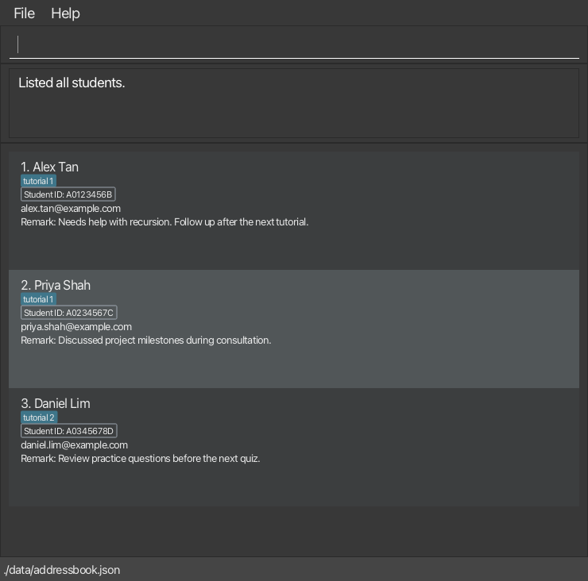

# TeachAssist User Guide

TeachAssist is a **desktop application for managing student records, optimized for use through a Command Line Interface (CLI)** while retaining the benefits of a Graphical User Interface (GUI). If you type quickly, TeachAssist can help you manage student information faster than traditional GUI applications.

<!-- * Table of Contents -->
<page-nav-print />

--------------------------------------------------------------------------------------------------------------------

## Quick start

1. Ensure that Java `25` or later is installed on your computer. 
   **Mac users:** Ensure you have the precise JDK version prescribed [here](https://se-education.org/guides/tutorials/javaInstallationMac.html).

1. Download the latest `.jar` file from [the TeachAssist releases page](https://github.com/AY2627S1-CS2103T-F12-1/tp/releases).

1. Copy the file to the folder you want to use as the _home folder_ for TeachAssist.

1. Open a terminal, `cd` to the folder containing the JAR file, and run `java -jar teach-assist-v1.6.jar`. 
   A GUI similar to the one below should appear in a few seconds. With no saved data file, the student list starts empty. 
   
   The screenshot shows an earlier label display; the current version displays group labels in lowercase.

1. Type a command in the command box and press Enter to execute it. For example, type **`help`** and press Enter to open the help window. 
   Some example commands you can try:

   * `list` : Lists all students.

   * `add n/John Doe i/A0123456B e/johnd@example.com r/Needs help with recursion` : Adds a student named `John Doe`.

   * `delete i/A0123456B` : Deletes the student whose Student ID is `A0123456B`.

   * `clear` : Deletes all students.

   * `exit` : Exits the app.

1. Refer to the [Features](#features) section below for details of each command.

TeachAssist fits its startup window within the available screen area, accounting for display scaling and the taskbar.
If a previously used monitor is disconnected, the saved window position is adjusted to fit the primary screen.
You can resize the window down to 450 × 400 logical pixels. At higher scaling, fewer student cards fit at once;
scroll the student list to reach the remaining students.

**Warning:** Run only one instance of TeachAssist at a time. If another window or a text editor changes the data file,
this window will reject its next save to avoid overwriting the newer data. Restart TeachAssist to load the latest data.

--------------------------------------------------------------------------------------------------------------------

## Features

<box type="info" seamless>

**Notes about the command format:**

* Replace words in `UPPER_CASE` with your values, e.g., `n/NAME` becomes `n/John Doe`.
* Square brackets mark optional parameters; `...` means the preceding parameter can be repeated.
* Use one command line and lowercase command words and prefixes. Parameters can be in any order.
* A prefix starts a parameter at the beginning of a whitespace-separated token. Unknown alphabetic prefixes such as
  `x/` are rejected, including inside remarks. Numeric text such as `8/10` and joined URLs remain ordinary text.
* `help`, `list`, `clear`, `undo`, and `exit` accept no arguments.
* When copying commands from a PDF, check that spaces around line breaks have been preserved.

</box>

### Whitespace and label matching

Leading and trailing whitespace is ignored around commands and values. This includes Unicode space separators,
such as non-breaking spaces, and Hangul fillers (`U+115F`, `U+1160`, `U+3164`, `U+FFA0`), which can also separate
commands and parameters. Names convert these characters to ordinary spaces and collapse repeated spaces.
Labels and remarks preserve their internal spacing, including Unicode spaces and Hangul fillers.
Zero-width spaces and byte order marks are not treated as whitespace.

Labels are stored and displayed in lowercase. Matching ignores case but requires the complete label with
**exact internal spacing**, including Unicode spaces and Hangul fillers. `Tutorial 1` and `Tutorial  1` are
different labels. An ordinary space, a non-breaking space, and a Hangul filler in the same position are also
different. This applies to finding, editing, and attendance
groups. `I` matches `i`; dotless `ı` is a different character.

### Field rules

These rules apply wherever a command accepts the field. Name and remark limits count Unicode code points after
whitespace handling; the label limit also applies after lowercasing.

| Field | Rules |
|-------|-------|
| Name | 1–100 characters, including a letter. Allows Unicode letters, combining marks, spaces, apostrophes (`'`, `’`), hyphens, and periods. Repeated spaces collapse; capitalization is preserved. |
| Student ID | Exactly nine ASCII letters or digits, stored in uppercase. Matching ignores case. No internal spaces or punctuation. Each student needs a unique ID; names can be shared. |
| Email | A supported `name@example.com` address, at most 254 characters, without spaces. The local part allows ASCII letters, digits, `.`, `_`, `+`, and `-`; the domain needs at least two dot-separated parts and a final part of 2–63 letters. Only the domain is lowercased. Mailbox existence is not checked. [Full constraints](DeveloperGuide.md#field-validation-errors). |
| Remark | Optional, at most 4,000 characters. Internal spacing and capitalization are preserved; dates and grades are not checked. Text starting after a space or similar separator with ASCII letters immediately followed by `/` is read as a parameter prefix, even in remarks. |
| Label / group | 1–60 characters after lowercasing, including a letter or digit. Allows Unicode letters, combining marks, digits, spaces, hyphens, underscores, apostrophes, parentheses, and periods. Internal spacing is preserved; capitalization is converted to lowercase for storage and display. |
| Date | A real calendar date in `YYYY-MM-DD` format, with zero-padded month and day, e.g., `2026-10-20`. |

For example, `r/Discussed algebra/ today` is rejected with `Unknown parameter: algebra/.` because
`algebra/` starts after a space. The same applies to `algebra/topic`; text after the slash does not change the rule.

Student cards wrap long names, emails, remarks, and labels. Resize the window or scroll to read taller cards.
Labels appear alphabetically in lowercase; empty remarks are hidden.

### Viewing help: `help`

Shows the Help window with the User Guide address. Click **Copy URL**, then paste it into your browser.

**Format:** `help`

**Example:** `help`

<!-- @@author sammeowwww -->
### Adding a student: `add`

Adds a student with identifying information and optional remarks and a group label.

**Format:** `add n/NAME i/STUDENT_ID e/EMAIL [r/REMARK] [l/LABEL_NAME]`

* Supply `n/`, `i/`, and `e/` once each, with non-empty values. Each optional parameter can appear once.
* Omit `r/` or use an empty `r/` for no remark. Omit `l/` for no label; an empty `l/` is rejected.
* An existing Student ID is rejected; records are not merged.
* Success displays the complete student list and reports the added student and total count.

**Examples:**

* `add n/John Doe i/A0123456B e/john@example.com`
* `add n/Jamie Lim i/A0234567C e/jamie@example.com r/Quiz 1: 8/10 l/tutorial 1`

A recognized prefix after `r/` starts another parameter: the second example stores `Quiz 1: 8/10` as the remark.
<!-- @@author -->

### Listing all students: `list`

Shows every student in the existing master-list order, replacing the current search or attendance view.

**Format:** `list`

**Example:** `list`

Reports `Listed all students.`, or `No students found.` when there are no records. No student data is changed or saved.

### Editing a student: `edit`

Updates a student identified by Student ID, including one hidden by the current search.

**Format:** `edit i/STUDENT_ID [n/NAME] [e/EMAIL] [r/REMARK] [l/LABEL_NAME]... [dl/LABEL_NAME]...`

* Supply `i/` and at least one change. Student ID itself cannot be edited.
* `i/`, `n/`, `e/`, and `r/` may each appear once. Names and emails cannot be empty; an empty `r/` clears the remark.
* Each `l/` adds a label; each non-empty `dl/` removes one. Do not repeat the same label under the same prefix.
* All removals happen before additions. Labels are stored in lowercase, so changing only capitalization has no effect.
* An empty `l/` clears **all** labels and cannot be combined with any other label change.
* Removing a missing label or adding a label still present rejects the entire edit.
* Other fields and attendance records are preserved, including attendance for removed labels.
* Success displays all students and reports the updated details, including any remark.

**Examples:**

* `edit i/A0123456B dl/tutorial 1 l/tutorial 2` replaces a label.
* `edit i/A0123456B l/ r/` clears all labels and the remark.

### Finding students by name, student ID, email, remark, or label: `find`

Searches the complete student list and replaces the previous search results.

**Format:** `find n/KEYWORD [MORE_KEYWORDS]` or `find i/KEYWORD [MORE_KEYWORDS]`
or `find e/KEYWORD [MORE_KEYWORDS]` or `find r/KEYWORD [MORE_KEYWORDS]` or `find l/LABEL_NAME`

* Supply exactly one non-empty search parameter. Matching ignores case.
* Name, ID, email, and remark searches match **any** supplied keyword, including partial matches.
* Label searches match a complete label using [exact internal spacing](#whitespace-and-label-matching), including
  Unicode spaces and Hangul fillers. A multi-word label is one search value.
* Reports the number of matches, including zero. Use `list` to restore all students; no records are changed.

**Examples:**

* `find n/tri sam` matches names containing `tri` or `sam`, such as Tristan and Samuel.
* `find l/tutorial 1` matches that complete label. `find l/Tutorial 1` also works because matching ignores case;
  the label remains stored and displayed as `tutorial 1`.

The former `filter` command has been replaced by `find l/LABEL_NAME`.

<!-- @@author sammeowwww -->
### Deleting a student: `delete`

Deletes a student and their remarks, labels, and attendance records.

**Format:** `delete i/STUDENT_ID`

* Supply exactly one non-empty `i/`. Matching ignores case.
* Students can be deleted even when hidden by the current search. That search is preserved.
* Use `undo` to restore the deleted student during the same session.

**Example:** `delete i/A0123456B`

### Recording attendance: `mark`

Records a student as present for a date and group.

**Format:** `mark i/STUDENT_ID d/YYYY-MM-DD l/GROUP`

* Supply each parameter once, with a non-empty value. The student must exist and currently have the group label.
* Student ID and group matching ignore case; group spacing follows [label matching](#whitespace-and-label-matching).
* Attendance for the same student, date, and group cannot be recorded twice.
* Students can be hidden by the current search. Other records and the current search are preserved.
* Success uses the stored lowercase group name and refreshes an open attendance view.

**Example:** `mark i/A0123456B d/2026-10-20 l/tutorial 1`

<!-- @@author -->

### Removing attendance: `unmark`

Removes an existing attendance entry for a student, date, and group.

**Format:** `unmark i/STUDENT_ID d/YYYY-MM-DD l/GROUP`

* Supply each parameter once, with a non-empty value. Matching follows the same rules as `mark`.
* The student and matching attendance entry must exist. You can still `unmark` an entry after removing the student's
  group label: removing the label hides the student from that group's report but retains past attendance until it is
  unmarked.
* Students can be hidden by the current search. Other records and the current search are preserved.
* Success uses the attendance entry’s stored lowercase group name and refreshes an open attendance view.

**Example:** `unmark i/A0123456B d/2026-10-20 l/tutorial 1`

### Viewing attendance: `attendance`

Shows present and absent students for a group and date, with totals.

**Format:** `attendance d/YYYY-MM-DD l/GROUP`

* Supply `d/` and `l/` once each, with non-empty values. Group matching follows [label matching](#whitespace-and-label-matching).
* Lists students who **currently** have the label, in master-list order, including students hidden by `find`.
* Students with an attendance entry are **Present**; others are **Absent**. Absences are not stored separately.
* Removing a student's label removes them from that group's report. It does not delete earlier attendance records:
  if the label is added back, the student's past **Present** status appears again for the same date.
* If no student currently has the requested label, including a label never used before, the report is empty with
  0 present and 0 absent.
* The attendance view replaces the student list. Successful `mark`/`unmark` commands refresh it; other successful
  commands return to the student list. Failed commands leave it unchanged.
* This command changes no data. It is blocked after a loading failure; fix or restore the data file and restart.
  A missing file or a successfully loaded empty file still permits an attendance report with zero totals.

**Example:** 
1. `mark i/A0234567C d/2026-10-20 l/tutorial 1`
2. `attendance d/2026-10-20 l/tutorial 1`

### Clearing all entries: `clear`

Deletes every student, including remarks, labels, and attendance, even when a search hides some students.

**Format:** `clear`

**Example:** `clear`

**Warning:** This takes effect without confirmation. Use `undo` to restore the records during the same session.
Clearing an empty list succeeds but creates no undo entry. The current search is retained; an attendance view closes.

### Undoing the latest data change: `undo`

Restores the records from before the latest successfully saved change and displays all students.

**Format:** `undo`

* Retains up to 100 changes during the current session, including changes to remarks, labels, and attendance.
* Commands that leave records unchanged create no undo entry; undo reverses the latest actual change.
* **There is no redo.** Restarting clears the undo history. Previous searches and window settings are not restored.
* A failed save preserves the records and undo history so you can retry.
* With no history, reports `Nothing to undo.`, keeps the student filter, and closes an open attendance view.

**Example:** `undo`

### Exiting the program: `exit`

Closes TeachAssist. Student data has already been saved after successful changes.

**Format:** `exit`

**Example:** `exit`

### Loading the data

TeachAssist loads `[JAR file location]/data/addressbook.json` at startup and reports the outcome.
A missing file starts an empty list. A successful load reports how many students were loaded.

If loading fails, the app opens with an empty list and **preserves the file**. `add`, `edit`, `delete`, `mark`,
`unmark`, `clear`, `undo`, `list`, `find`, and `attendance` are blocked. `help` and `exit` remain available.
Close the app, fix or restore the file, then restart. Deleting the file starts a fresh empty list.

### Saving the data

Changes are saved automatically after successful `add`, `edit`, `delete`, `mark`, `unmark`, `clear`, and undo of a change.
Viewing commands do not save student data. If saving fails, the proposed change is not applied: records, the current
view, undo history, and the previous saved file are preserved. Restore writable storage and retry the command.

### Editing the data file

Close TeachAssist and back up `data/addressbook.json` before editing it. Use valid field values and unique Student IDs.
Invalid JSON or records prevent loading, including extra text or a second JSON value after the student-data object.
See [Loading the data](#loading-the-data) for recovery, and the [DG data-file reference](DeveloperGuide.md#loading-errors)
for JSON structure, normalization, optional fields, and duplicate rules.

The app keeps its data, `preferences.json`, and `addressbook.log.*` beside the JAR, even when launched from another
directory. Existing files in the launch directory are not imported automatically. Use a writable home folder.

--------------------------------------------------------------------------------------------------------------------

## Troubleshooting

| Problem | What to do |
|---------|------------|
| Student data fails to load | Close the app, fix or restore `data/addressbook.json`, and restart. See [Loading the data](#loading-the-data). |
| Student data has changed outside this window | Another window or a text editor changed `data/addressbook.json` after this window loaded it. The attempted change was not saved. Restart TeachAssist to load the latest data, then retry the command. |
| Changes cannot be saved | Check folder permissions and available storage, then retry. Detailed causes are in [Saving errors](DeveloperGuide.md#saving-errors). |
| Main window cannot initialize | A fatal error dialog appears; dismissing it exits the app. Check the exception details and log files before retrying. |

For exact messages and validation order, see [Developer Guide — Appendix: Errors](DeveloperGuide.md#appendix-errors).

--------------------------------------------------------------------------------------------------------------------

## FAQ

**Q**: How do I transfer my data to another computer? 
**A**: Install the app on the other computer. With TeachAssist closed on both computers, copy the `data` folder into the new JAR’s folder. Back up any existing data before replacing it.

--------------------------------------------------------------------------------------------------------------------

## Known issues
- None thus far. 
--------------------------------------------------------------------------------------------------------------------

## Command summary

Action     | Format, Examples
-----------|----------------------------------------------------------------------------------------------------------------------------------------------------------------------
**Add**    | `add n/NAME i/STUDENT_ID e/EMAIL [r/REMARK] [l/LABEL_NAME]`   e.g., `add n/James Ho i/A0123456B e/jamesho@example.com r/Needs help with recursion l/discrete math tutorial`
**Attendance** | `attendance d/YYYY-MM-DD l/GROUP`  e.g., `attendance d/2026-10-20 l/tutorial 1`
**Clear**  | `clear`
**Delete** | `delete i/STUDENT_ID`  e.g., `delete i/A0123456B`
**Edit**   | `edit i/STUDENT_ID [n/NAME] [e/EMAIL] [r/REMARK] [l/LABEL_NAME]... [dl/LABEL_NAME]...`  e.g., `edit i/A0123456B dl/tutorial 1 l/tutorial 2`
**Find**   | `find n/KEYWORD [MORE_KEYWORDS]` or `find i/KEYWORD [MORE_KEYWORDS]` or `find e/KEYWORD [MORE_KEYWORDS]` or `find r/KEYWORD [MORE_KEYWORDS]` or `find l/LABEL_NAME`  e.g., `find n/James Jake`
**List**   | `list`
**Mark**   | `mark i/STUDENT_ID d/YYYY-MM-DD l/GROUP`  e.g., `mark i/A0123456B d/2026-10-20 l/tutorial 1`
**Unmark** | `unmark i/STUDENT_ID d/YYYY-MM-DD l/GROUP`  e.g., `unmark i/A0123456B d/2026-10-20 l/tutorial 1`
**Undo**   | `undo`
**Help**   | `help`
**Exit**   | `exit`
